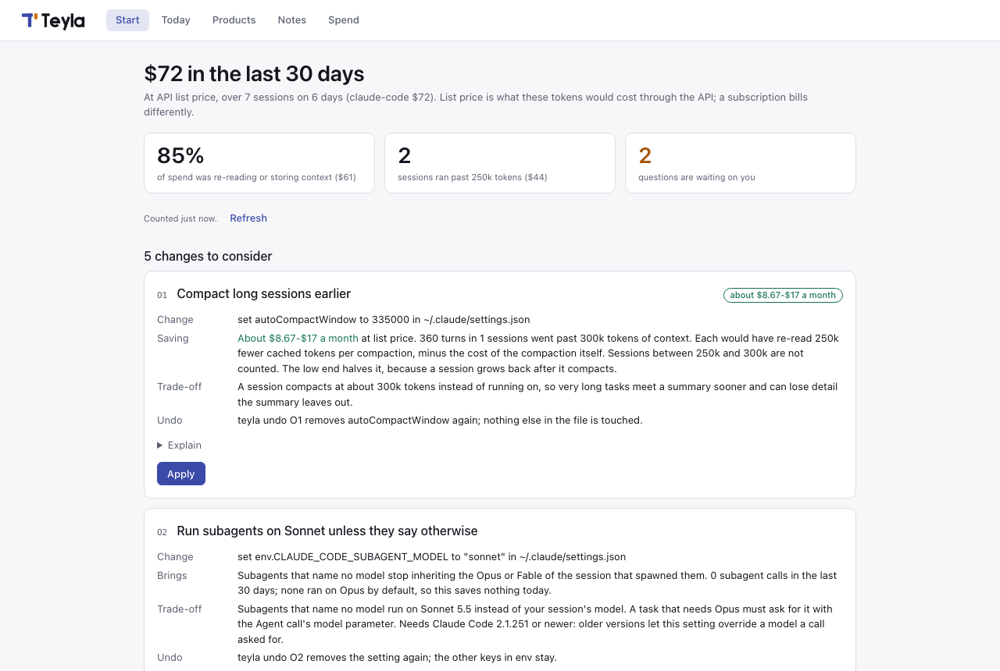
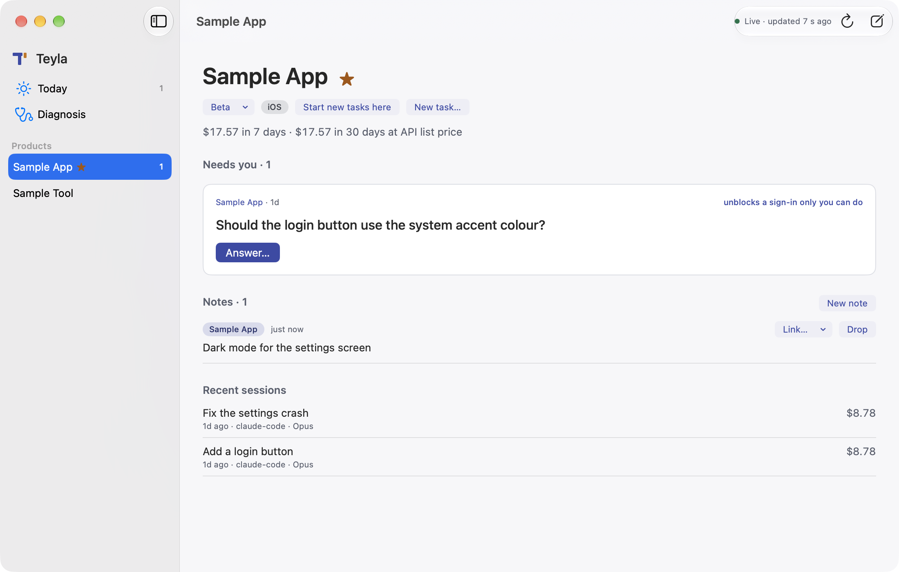

<h1 align="center"><picture>
  <source media="(prefers-color-scheme: dark)" srcset="brand/lockup-dark.svg">
  
</picture></h1>

<p align="center"><b>The control room for working with AI agents on one Mac.</b><br>
Tick the packs you need. Teyla turns on only those, and names another one when its problem shows up.</p>

Teyla reads your Claude Code and Codex sessions on your Mac, shows what they cost and what's waiting on you, and fixes the waste. Nothing about your sessions leaves your Mac unless you turn it on.



<p align="center"><a href="#set-it-up-with-your-agent">Set up</a> · <a href="#pick-your-packs">Packs</a> · <a href="docs/GUIDE.md">Guide</a> · <a href="docs/COMMANDS.md">Commands</a> · <a href="docs/PRIVACY.md">Privacy</a> · <a href="CHANGELOG.md">Changelog</a> · <a href="CONTRIBUTING.md">Contributing</a> · <a href="LICENSE">Apache-2.0</a></p>

## Set it up with your agent

Paste this into Claude Code or Codex:

```
Set up https://github.com/zaitsew/teyla
```

The agent reads [AGENTS.md](AGENTS.md), installs Teyla and shows what your sessions cost. It then shows the packs as one checklist and asks about each change on its own, with the saving and the way back.

## Or by hand

You need a Mac and [uv](https://docs.astral.sh/uv/). It downloads Python 3.12 (about 25 MB) if the Mac has no Python 3.11 to 3.13.

```bash
uv tool install --python 3.12 git+https://github.com/zaitsew/teyla
teyla start          # the diagnosis, the checklist of packs, then each change: yes, no or explain
```

Try it without installing. It changes no setting of your tools and keeps its counts in `~/.teyla`:

```bash
uvx --python 3.12 --from git+https://github.com/zaitsew/teyla teyla start
```

## Pick your packs

Teyla is a kit. `teyla start` opens with this checklist, and only the ticked packs are turned on.

| | Pack | The problem | What Teyla does |
|:-:|---|---|---|
| 💸 | **Token cost** `cost` | Long sessions re-read their whole context every turn | Compacts earlier, runs subagents on Sonnet, reading on Haiku |
| 🛡️ | **Machine guard** `load` | Parallel agents swap the Mac until it hangs or panics | Admits one heavy build or simulator at a time; holds new ones under memory pressure |
| 🧹 | **Disk cleanup** `disk` | DerivedData, worktrees and simulators fill the disk | Shuts down idle simulators, sweeps temp build output every hour |
| 📥 | **Questions and ideas** `inbox` | A session ends on a question and nobody reads it | Keeps every open question and your long prompts on one screen |
| 📜 | **One policy** `policy` | A correction made in Claude Code is unknown to Codex | One `POLICY.md`, linked into every agent |
| ☀️ | **Morning check** `daily` | A broken hook goes unseen for weeks | A daily check and a six-line weekly digest |
| 🔐 | **Security** `security` | A secret ends up in a commit or a public repo | Refuses a publish that carries a secret; audits repos and dependencies |
| 🎨 | **UX and UI** `design` | Screens ship with noise and weak hierarchy | Checks UI code against one standard; judges two screens |
| 🚀 | **Ship and test** `ship` | A build is uploaded, but no tester can install it | Tracks each platform, unreviewed merges, comments from the real app |
| ✍️ | **Writing** `writing` | Replies and READMEs are long, padded and out of date | Measures filler, checks drafts against a voice chart |

The first six are automatic: they change a setting, a hook or a launchd job. The last four add commands you run on a repo and install nothing. `teyla features` shows which are on; `teyla features on disk` turns one on later. [FEATURES.md](docs/FEATURES.md) lists every switch.

When a problem shows up, Teyla names the pack that solves it. The Mac hits critical memory, the disk drops under 25 GB, or `teyla start` prices token waste: `teyla doctor` and the session-start banner say so once.

```
teyla: new — feature:disk WARN: the disk is down to 9.1 GB free; the Disk cleanup pack is off
```

## Cost and waste

`teyla start` reads the Claude Code, Codex, Grok, Cursor and Hermes sessions already on your disk and prints a card like this one (the numbers are made up):

```
Last 30 days: $1,840 at API list price over 212 sessions on 24 days (claude-code $1,610, codex $230).
41% of it ($754) was re-reading and storing context; 9 sessions ran past 250k tokens of context and cost $402.
Subagents cost $390; Opus ran 64% of that.
  O1 Compact long sessions earlier: about $95-$190 a month
  O2 Run subagents on Sonnet unless they say otherwise: about $60-$140 a month
```

*List price* is what the tokens would cost through the API; a subscription bills differently. *Context* is everything a session has read so far, re-read on every turn. A *subagent* is a helper agent a session starts for one side task. `teyla spend --days 7` and `teyla web` show the same numbers later.

## What's waiting on you

`teyla today` is the daily screen: the questions agents left, your notes, this week's spend against last week's, and one next step. `teyla asks` lists every open question, oldest first, with a link that reopens the session.

A *product* is a repo, or a few, that you ship as one thing. `teyla product init` proposes the list from your repos. `teyla portfolio` gives each one a health word (off track, at risk, on track, parked), the reason, and one line per platform: version, build, live, in review or behind. `teyla note "try a dark icon"` keeps an idea under a product.

## One policy for every agent

`teyla policy sync` hands one `POLICY.md` to Claude Code, Codex, Grok, Cursor and Hermes. `teyla harness sync` adds *hooks* to them: small scripts an agent runs at set moments, such as session start. `teyla routine install` schedules the daily and weekly checks. [GUIDE](docs/GUIDE.md) has the detail.

## The Mac and iPhone apps

<picture>
  <source media="(prefers-color-scheme: dark)" srcset="docs/img/mac/product-dark.png">
  
</picture>

Teyla for Mac is a window and a menu-bar icon: today's brief, questions you answer in place, the portfolio and the diagnosis. It runs the `teyla` command, so install that first, then build the app (macOS 15, Xcode):

```bash
brew install xcodegen && git clone https://github.com/zaitsew/teyla && cd teyla/apps/mac && ./install.sh
```

The iPhone app reads a signed folder in your own iCloud Drive that `teyla relay on` keeps current. There is no Teyla server and no account. [APP.md](docs/APP.md) has the contract.

## Privacy

Teyla reads files on your Mac. It sends nothing about your sessions unless you run one of these:

| What | When | Sends |
|---|---|---|
| Update check | once a day, on by default | the version number, to GitHub |
| `teyla spend`, `teyla reviews`, `teyla state` | when you run them | repo names, PR numbers, your login, through your own `gh` |
| `teyla answer`, `teyla run`, `--model` flags | only when you ask | text, to your model provider under your own login |
| `teyla relay on` | off by default | open questions and session titles, to your iCloud Drive |

`teyla web` listens on 127.0.0.1 only. Safe mode, `teyla config set safe.enabled=true`, closes most of these calls. Every call, with its host: [docs/PRIVACY.md](docs/PRIVACY.md).

## Undo and uninstall

```bash
teyla changes              # every change Teyla made, and whether it is undone
teyla undo O1              # put back only the setting Teyla wrote (O1 to O4)
teyla features off load    # a pack's switches off, its O1 to O4 changes undone
teyla uninstall --dry      # list what Teyla would remove: links, hooks, jobs
teyla uninstall && uv tool uninstall teyla
```
